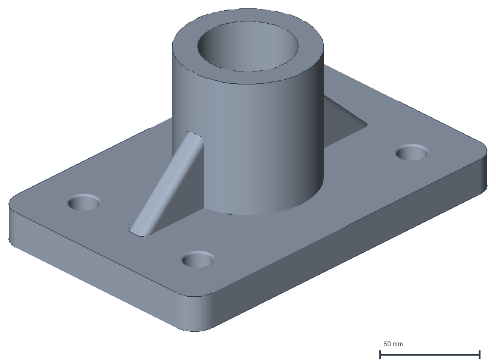
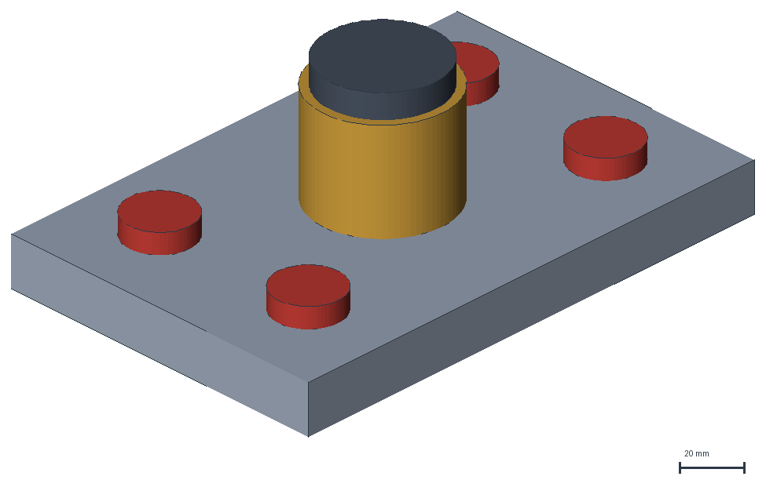
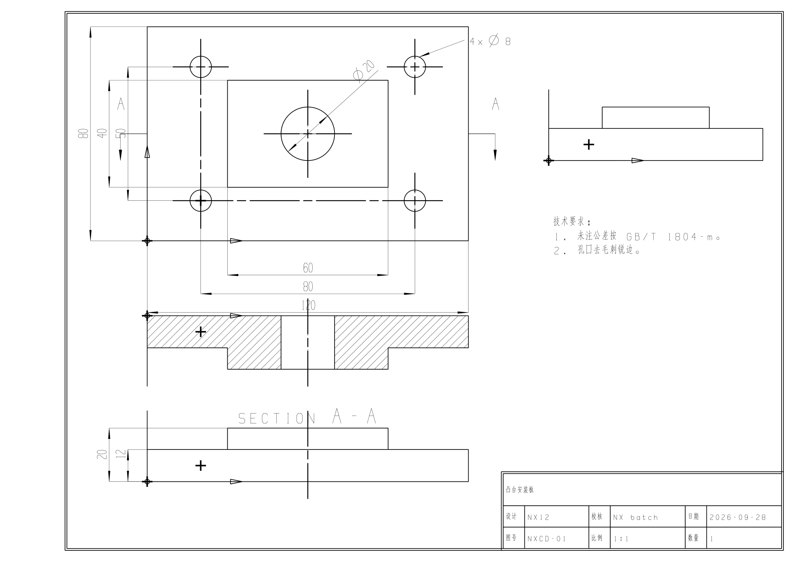
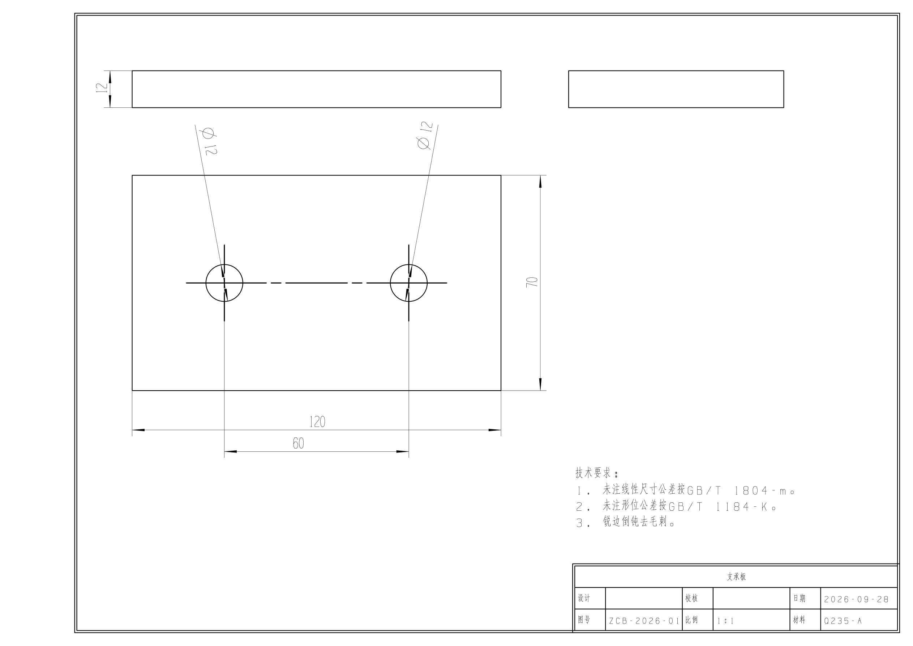
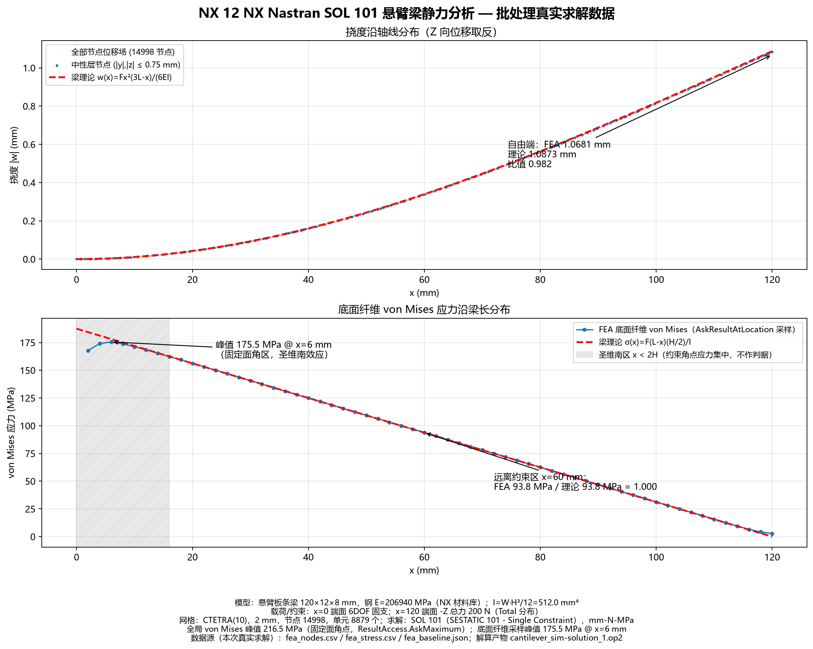
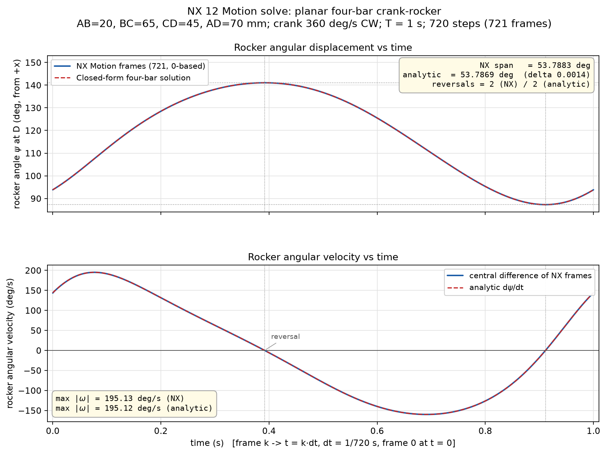
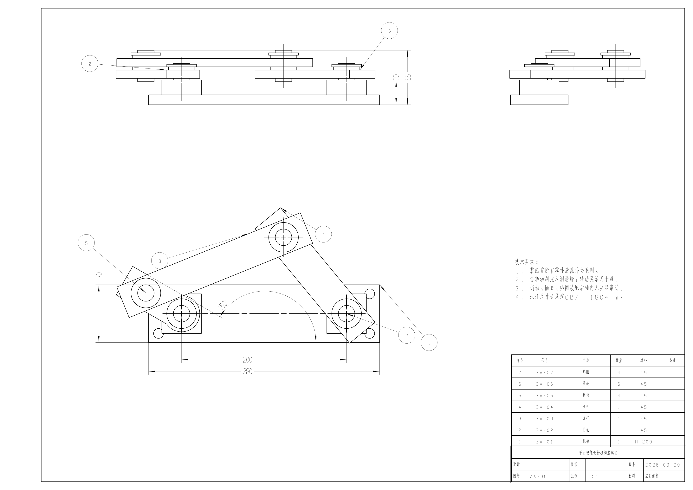
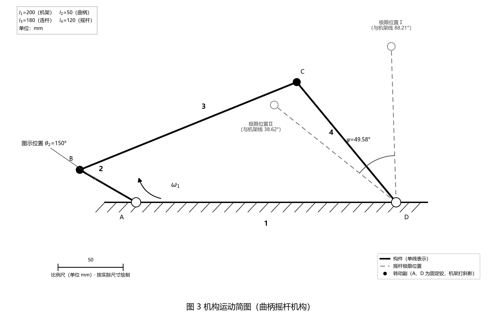
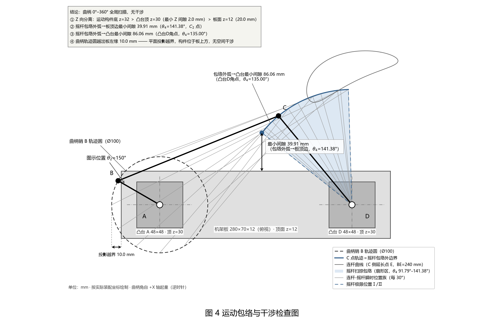

# nxopen-journal

[中文](README.md) | English

Current version 1.2.0 (see [CHANGELOG.md](CHANGELOG.md)).

An agent skill for Siemens NX 12. After installation, an agent can write NXOpen Python journal
scripts from natural-language instructions, run them headlessly through NX 12 in batch mode, and
produce solid models, assemblies, Drafting drawings, NX Nastran FEA results and NX Motion
simulations.

## Applies to

Windows 11 + NX 12 (currently 12.0.0.27). Other platforms and NX versions are untested.

### Python versions

| Purpose | Interpreter | Version |
| --- | --- | --- |
| NX journal execution | NX 12 embedded Python | 3.6.1 (fixed, cannot be replaced) |
| Repository checks, PDF verification | Host Python | 3.11+ |
| nxopen MCP | Host Python | 3.11+ (upstream `requires-python = ">=3.11"`) |

The host tools themselves need less than 3.11: `check_repo.py` needs 3.8+ and current pymupdf needs
3.10+. Using 3.11+ for both the host tools and nxopen MCP avoids maintaining two Python environments.

The skill itself is written in Chinese: `SKILL.md` and `references/*.md` are the working documents
the agent reads. This page is the English entry point.

## What it covers

| Domain | Covered |
| --- | --- |
| Modeling | sketches, extrude and revolve, boolean, shell and draft, patterns (linear, circular, along path, helix, polygon, general, reference), hole package (three non-threaded types; threads use a pilot hole plus annotation), layers and categories, STL export |
| Assembly | assembly structure, mating constraints, draggable mechanism, two routes to a revolute joint, two geometric routes for interference checking |
| Drafting | base and projected views, detail view, sections (stepped, half, revolved), dimensions and centrelines, radius dimensions |
| FEA | Nastran SOL101 static, 2D shell mesh, solve-level calibration, solution and boundary-condition descriptors |
| Motion | links and joints (revolute, slider, gear coupler), drivers, solving, result extraction |

Five tools come with it: `scripts/check_journal.py` (static check of a journal against
a rule base of measured NX 12 pitfalls), `scripts/run_journal_batch.bat` (headless replay),
`scripts/gb_drawing.py` (GB-style drawing kit: A4 frame, pinned views, title block, tech
note and dimension lanes — any journal can `import gb_drawing`), the case standard layer
`scripts/nxlib/` (test framework plus recipes for five domains such as modeling, assembly
and drafting; regression cases import it instead of copying their own), and the offline figure
chain in `scripts/render/` (batch sessions cannot capture images, so solids are rendered
from STL outside NX and drawing PDFs are rasterised on the host).

## Figures from real runs

The six module images below come from batch replays on this machine. Six cold-start agents, each
with no memory, ran the modules independently: each received only the skill documents and one task
sentence, then designed its own part, wrote the journal, passed static checks, replayed in batch
and verified the result; the coordinator only accepted the final figure.
Solids and assemblies are rendered outside NX from STL exported by the same run (a batch session
cannot capture an image, see limitations), the drawings are PDFs the run wrote directly, and both
charts plot real solve data written to disk.

| Modeling: bearing pedestal, ribs, hole pattern (trimetric render) | Assembly: plate, pins, bushing and cap, mates colour-coded |
| --- | --- |
|  |  |

The assembly figure colour-codes the four red pins, the gold bushing and the dark cap on the grey
base plate. 13 persistent constraints hold the seven components and every pose was read back and
verified against its design value.

| Drafting: three views, section A-A, dimensions, centrelines | GB drawing: A4 sheet, frame, title block, notes |
| --- | --- |
|  |  |

All nine dimensions in the drafting figure are UF-related objects attached to geometry, and the PDF
text layer was token-checked with pymupdf. The GB figure's sheet, frame, title block and general
notes come from the skill's gb_drawing module in one pass.

| FEA: SOL101 cantilever vs beam theory (two panels) | Motion: rocker angle and angular velocity vs analytic (720 steps) |
| --- | --- |
|  |  |

The FEA figure overlays the real 14998-node displacement field on beam theory (free-end ratio 0.982)
and samples bottom-fibre stress against the analytic distribution (ratio 1.000 mid-span; the
Saint-Venant corner region is shaded and not used as a criterion). The motion figure plots per-frame
data of a 720-step solve: the rocker swing span differs from the closed form by 0.0014 degrees and
the reversal count matches.

### Advanced cold start: the ZA crank-rocker assembly

Beyond the six modules the same cold-start discipline ran an advanced round: a crank-rocker
assembly of 7 part types / 18 instances, modelled, mated and drafted into a complete assembly
drawing in one pass, then two kinematics charts derived from the assembly parameters. The assembly
drawing is written directly by an NX 12 batch Drafting session; the two kinematics charts come from
a verification script that cross-checks an analytic solution against a numeric sweep and plots with
matplotlib (not NX output). All three figures went through the same acceptance: independent
recomputation plus a visual gate.

| Assembly drawing: three views + balloons + BOM + title block (A3) | Kinematic diagram: GB symbols, limit positions |
| --- | --- |
|  |  |

Every one of the 7 balloons attaches to real geometry and the 7 BOM rows map one-to-one onto the
parts; the three views fill the frame with the notes placed right above the BOM. Vertical dimension
text is forced parallel to its dimension line through the .NET preferences API (the UF default is
unstable and stacks digits at random under the same code path). The za10→za40 script chain carries
its own audit gate, and the sheet passed after three visual-review iterations.

| Sweep envelope & interference check: envelope arc, coupler curve, clearance callouts |
| --- |
|  |

The kinematics numbers were recomputed independently: Grashof holds, γmin=55.77°, rocker swing
49.58°, limit positions 91.79°/141.38°, minimum envelope-to-plate clearance 39.91 mm, with the
analytic values and a 721-step sweep agreeing within 0.009 mm. The crank path circle projects
10 mm past the plate edge while the minimum Z clearance is 2 mm, so nothing collides in space.

## Requirements

| # | Requirement | How to check | If missing |
| --- | --- | --- | --- |
| 1 | Windows 11 + Siemens NX 12 (12.0.0.27) with the NXOpen automation interface | `%NX_HOME%\NXBIN\run_journal.exe` exists | Batch replay cannot run; none of the 33 gated cases run, only the static check is left |
| 2 | `NX_HOME` pointing at the NX install root | defaults to `D:\UG-NX12`; set `NX_HOME` if yours is elsewhere | The batch wrapper prints an error and exits with code 2 instead of silently using the wrong path |
| 3 | An agent that loads skills | put the directory into the agent's skill directory and let the agent read `SKILL.md` | The skill never triggers. Routing comes from the frontmatter of `SKILL.md`; nothing to compile or register |
| 4 | Python 3.11+ (host) | `python -V`. `check_journal.py`, `check_repo.py` and the PDF value check use it (the latter also needs pymupdf) | Journals are unaffected: NX runs them with its embedded Python 3.6.1; the host Python only runs checks and MCP |
| 5 | NX Nastran solver licence | the solve log prints a `NASTRAN LICENSE:` line near the top | Cases 09 and 25 cannot run; everything else can. These two really call the solver, they are not optional |
| 6 | nxopen MCP | see below | Optional; read the dependency notes first |

### nxopen MCP

The MCP server is a separate project ([nxopen-mcp](https://github.com/mingfeng6684/nxopen-mcp)) and
is the main defence against hallucinated APIs: it looks answers up in NX's own API documentation.
Half of its tools need a local embedding service.

Upstream has published v0.2.0 (latest) and v0.1.0, with tags and releases. Install with
`pip install "nxopen-mcp[embed,reflect]"` (upstream `requires-python` is >=3.11), or use `uvx nxopen-mcp`
to run it without installing. The local machine has an editable source install, version 0.2.0, and
the `NXOPEN_MCP_*` environment variables below are written for that version. Build the index once
against the local NX installation, and use the same embedding model for the index and the queries.

| Tool | Needs | When the embedding service is down |
| --- | --- | --- |
| `get_class` / `get_member` | local index | works |
| `search_api` / `find_builder` | local index + embedding service | fails; there is no keyword-search fallback |

Any OpenAI-compatible `/v1/embeddings` endpoint works (`llama-server --embedding`, Ollama,
LM Studio) as long as it serves `bge-m3` (1024 dimensions). Point the MCP at it:

```
NXOPEN_MCP_EMBEDDER=llama
NXOPEN_MCP_OLLAMA_URL=<embedding service endpoint, e.g. http://127.0.0.1:11436>
NXOPEN_MCP_OLLAMA_MODEL=bge-m3
```

## Install

This section is a task description that can be handed directly to an agent. Send the block below to
the agent; the skill source is already set to this repository.

```text
Task: install and verify the nxopen-journal skill.

Skill source: https://github.com/EVOL233awa/nxopen-journal

Steps:
1. Install the skill
   - Clone or download the repository into the agent's skill directory, keeping the directory name nxopen-journal:
     git clone https://github.com/EVOL233awa/nxopen-journal
   - Codex CLI: ~/.codex/skills/
   - ZCode: ~/.zcode/skills/
   - Claude Code: ~/.claude/skills/
   - Other agents: follow their documentation.
   - Confirm SKILL.md, scripts/run_journal_batch.bat and scripts/tests/RUN_TESTS.bat exist.

2. Check the runtime environment
   - OS: Windows 11.
   - NX: Siemens NX 12 (currently 12.0.0.27). Other NX versions are untested.
   - Confirm %NX_HOME%\NXBIN\run_journal.exe exists. NX_HOME defaults to D:\UG-NX12; set it if NX is installed elsewhere.
   - Confirm the embedded NX interpreter is Python 3.6.1; write journals with 3.6 syntax.
   - Host Python: 3.11+ (for check_repo.py, check_journal.py, PDF verification and nxopen MCP; independent of the NX embedded interpreter).

3. Run static checks and regression
   - Run python scripts\check_repo.py and confirm CHECK_REPO_OK.
   - Run scripts\tests\RUN_TESTS.bat and report every case.
   - Verdict: the expected marker for each case appears and no _FAIL appears; the last line is === ALL TESTS PASSED ===.
   - On failure, report the case number, the failing item and the last 50 log lines; do not report only the exit code.

4. Configure nxopen MCP (optional)
   - Install: pip install "nxopen-mcp[embed,reflect]" (Python 3.11+), or uvx nxopen-mcp.
   - The latest upstream release is v0.2.0.
   - Build the index against the local NX installation: nxopen-mcp index --nx-path <NX install root>.
   - The embedding service must expose an OpenAI-compatible /v1/embeddings endpoint and serve bge-m3 (1024 dimensions).
   - Set NXOPEN_MCP_EMBEDDER, NXOPEN_MCP_OLLAMA_URL and NXOPEN_MCP_OLLAMA_MODEL.
   - Verify that GET {url}/v1/models (llama.cpp) or GET {url}/api/tags (Ollama) lists bge-m3.
   - If MCP is not configured, state that API checks will fall back to dir() and the UGOPEN headers.

5. Report
   - Install path and skill directory.
   - NX version, NX_HOME and Python version.
   - Results of check_repo and RUN_TESTS.
   - Missing items and decisions that need a human (NX version other than 12, different install drive, etc.).
```

### Day-to-day use

Describe the job in plain language, for example:

> With nxopen-journal, model a 120x80x12 bracket with four corner M8 counterbore holes and
> export three views.

The agent reads `SKILL.md`, then the domain file for the task, writes the journal, runs the static
check, and replays it. The output is `.prt` files and drawings.

### Verify the install

Run the full regression suite once; a final summary line of all tests passed means this machine is
ready:

```
> scripts\tests\RUN_TESTS.bat
PASS 27_radius_dim.py
PASS 28_pattern_helix.py
PASS 29_interference.py
PASS 30_fea_descriptors.py
PASS 31_drafting_sections.py
PASS 32_pattern_enums.py
PASS 33_gb_sheet.py
PASS 34_involute_gear.py
PASS 35_assembly_preload.py
PASS 36_motion_slider.py
PASS 09_fea_static.py
PASS check_journal rule selftest - counter-examples hit, clean passes
PASS pdf value check - test 19 annotation values
=== ALL TESTS PASSED ===
```

33 gated cases pass, plus three one-shot API probes that are kept as evidence and are not part of
the check. By default the run deletes the artifacts under `scripts/tests/parts/`, including the
Nastran intermediate files, because every run rebuilds them completely.

## Regression cases

The suite is grouped by domain; what each case covers and how its negative check is done is
recorded in `scripts/tests/README.md`.

| Domain | Cases |
| --- | --- |
| Modeling | 01 02 03 05 08 14 15 22 26 28 32 34 |
| Assembly | 04 10 16 17 29 35 |
| Drafting | 06 07 19 20 21 27 31 33 |
| FEA | 09 24 25 30 |
| Motion | 18 23 36 (16 and 17 cover assembly-level joints) |

Three further one-shot API probes are not part of the check and are kept for reference.

## Why this skill

NXOpen is hard less because of syntax than because it is difficult to tell from the documentation which
calls survive NX 12 batch mode and which ones take the process down. This skill turns those
judgements into recipes: each conclusion is first checked against nxopen MCP, then run in NX 12
batch mode. Conclusions that can be guarded have regression cases, so a change that breaks one
shows up when running `scripts\tests\RUN_TESTS.bat`. Dead ends are inlined as a one-line constraint
in the matching route ("when this happens, do that"); only cross-domain high-frequency traps stay in
`SKILL.md` §1. For interference checking use the boolean-intersect route and
the `SimpleInterference` route, for threaded holes use "pilot hole plus annotation".

## Known limitations

- Validated on Windows 11 + NX 12.0.0.27; other platforms and versions are untested.
- A batch session cannot capture an image: the image-capture builder commits without writing a file,
  and `Disp.CreateImage` raises a memory access violation. View orientation and rendering style do
  work. So images come from two routes instead: drawings as PDF out of Drafting, and solid geometry
  as STL rendered outside NX, which is where this README's model and assembly figures come from.
- Case 26 keeps one native crash as a boundary record, which is why exit codes cannot be used as the
  verdict. The crash happens in its own NX process, and the skill never writes into the NX
  installation.
- Of the nine pattern types, `Linear`, `Circular`, `AlongPath`, `Helix`, `Polygon`, `Spiral`,
  `General` and `Reference` all produce instances through `PatternFeatureBuilder` (cases 01, 02, 22,
  28, 32); `Mirror` is rejected at commit, so mirrored features go through
  `Features.MirrorFeatureBuilder` (case 03).
- The skill only generates scripts and artifacts; it does not modify the NX installation, and
  scripts and models are written to the working directory.

## Repository layout

```
nxopen-journal/
├── SKILL.md                        entry layer: rules / environment / skeleton / common operations / logging / workflow / routing
├── CHANGELOG.md                    version history (Keep a Changelog)
├── references/                     eight domain files: modeling / assembly / drafting / drafting-annotation / fea / motion / gb-drawing / reverse-engineering
├── images/                         figures from real runs
├── scripts/
│   ├── gb_drawing.py               GB-style drawing kit (frame / pinned views / title block / tech note / dimension lanes / PDF)
│   ├── nxlib/                      case standard layer (test framework + recipes for five domains, imported by the cases)
│   ├── check_journal.py            static check (AST + rule base of measured pitfalls)
│   ├── check_repo.py               repo self-check (Py3.6 syntax / case list / doc structure / file list / standard-layer exclusivity / doc conciseness)
│   ├── run_journal_batch.bat       single-file batch replay (NX_HOME parameterised)
│   ├── render/                     offline figure chain (shaded STL rendering, PDF rasterising, trim and scale bar)
│   └── tests/                      regression suite (33 gated cases + 3 one-shot probes) plus its own README
└── agents/openai.yaml              Codex / OpenAI front-end config for cross-agent portability
```

The repository ships a cloud CI (`.github/workflows/ci.yml`) that runs the Python 3.6 syntax check,
`check_journal.py` and `scripts/check_repo.py` on every push; none of the three needs NX. The
regression suite itself needs a machine with NX 12 installed.
