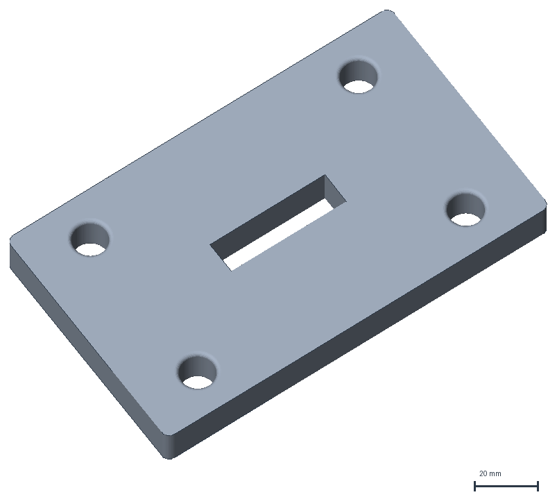
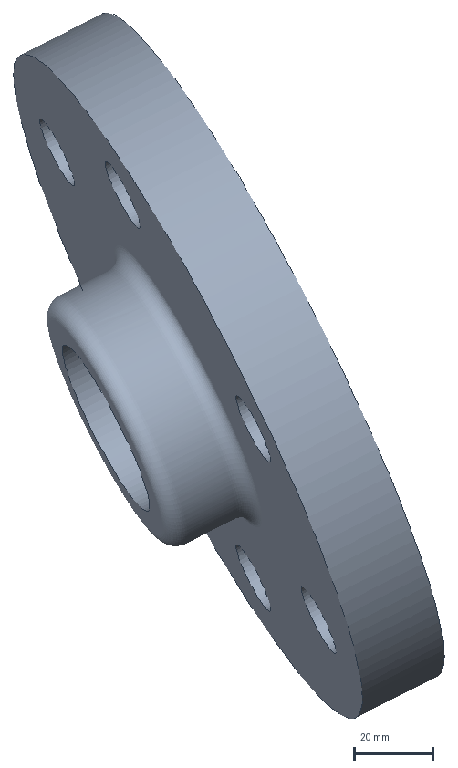
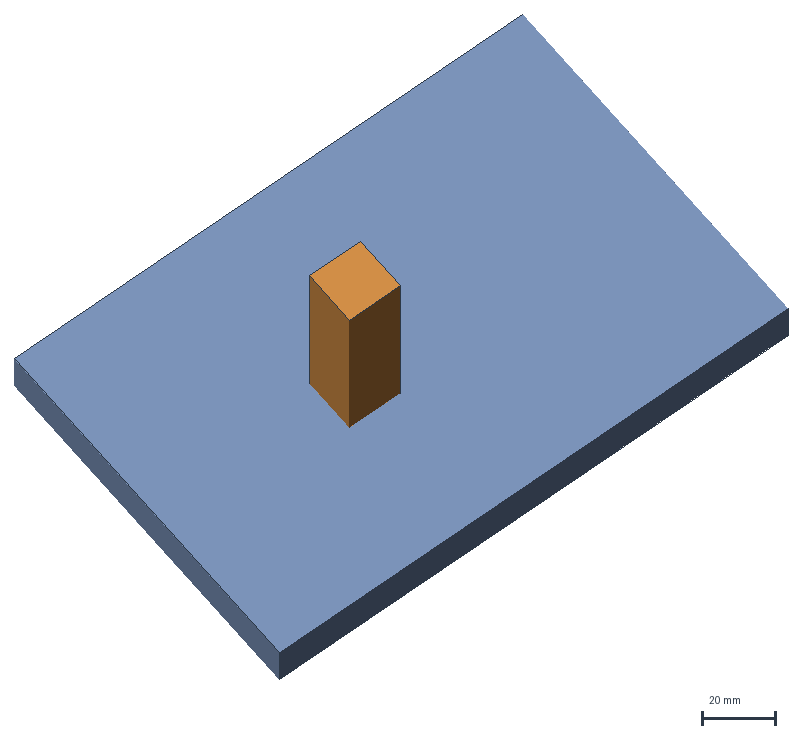
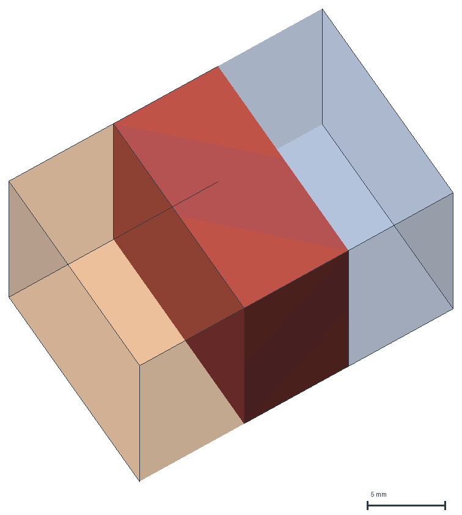
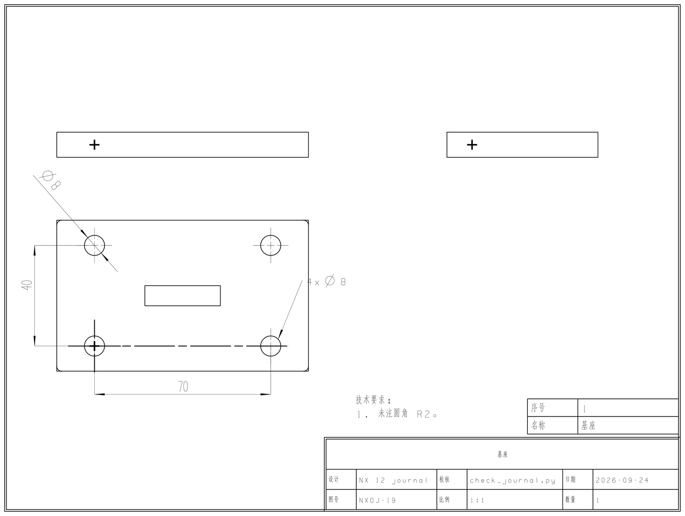
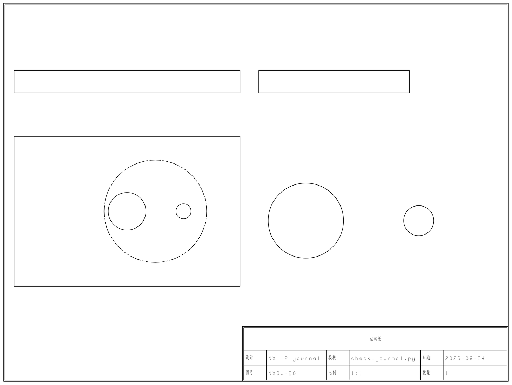
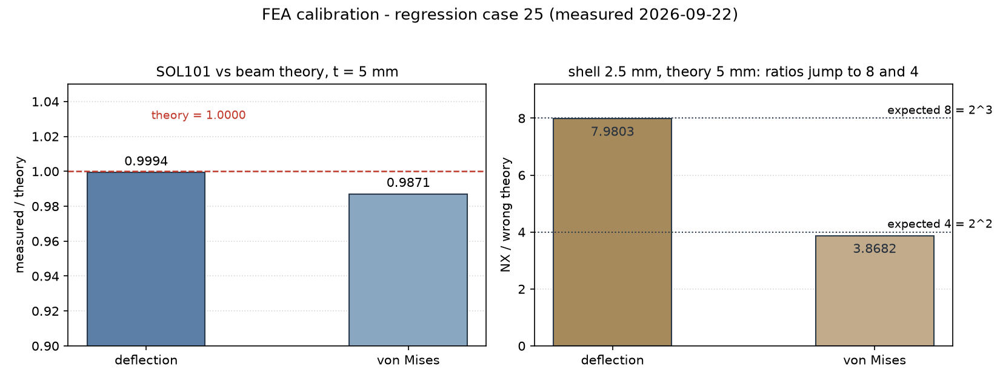
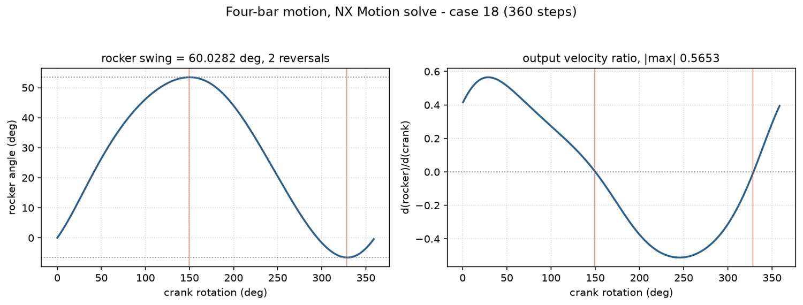

# nxopen-journal

[English](README.en.md) | 中文

面向 Siemens NX 12 的 agent 技能包（作者只在 NX 12.0.0.27 上实测过）。装上之后，你用的 agent
（ZCode、Codex CLI、Claude Code 等）可以替你编写 NXOpen Python journal 脚本，并在本机 NX 12 中以
无图形界面的批处理方式回放执行，产出三维模型、装配、Drafting 工程图、Nastran 有限元与 Motion
运动仿真结果。使用者本人不需要懂 NXOpen 或 Python。

## 能做什么

技能覆盖 NX 自动化的五个域，工作方式统一为 agent 写 journal、批处理回放、校验产物：

| 域 | 覆盖内容 |
| --- | --- |
| 三维建模 | 草图、拉伸与旋转、布尔、抽壳与拔模、阵列（线性、圆周、沿路径、螺旋、正多边形、目标点、引用已有阵列）、孔包四种孔型、图层与类别、STL 导出 |
| 装配 | 装配结构、配对约束、可拖动机构、转动副两条路线、干涉检查两条几何路线 |
| Drafting | 三视图与投影视图、局部放大、剖视（阶梯剖、半剖、旋转剖）、尺寸与中心线标注、半径尺寸 |
| 有限元 | Nastran SOL101 静力、2D 壳网格、求解级标定、解算方案与边界条件描述符 |
| 运动仿真 | 连杆、转动副、固定副等连接件，驱动、求解与结果提取 |

除生成脚本外，技能自带五类工具：静态检查 `scripts/check_journal.py`、批处理回放入口
`scripts/run_journal_batch.bat`、国标出图标准件 `scripts/gb_drawing.py`（A4 图框/三视图钉位/标题栏/
技术要求/尺寸道位一次到位，任何 journal `import gb_drawing` 即用）、用例标准层 `scripts/nxlib/`
（测试框架与建模/装配/制图等五域配方，回归用例 import 它而非各自复制一份），以及 `scripts/render/`
的离线出图链（批处理截不了图，三维图由 STL 在 NX 之外渲染、工程图 PDF 栅格化）。

## 实跑产物

下面每张图都是本机 NX 12 批处理跑出来的，不是示意图。三维与装配图由同一次回放写出的模型导出 STL
后在 NX 之外渲染（批处理会话截不了图，见已知限制），工程图是回放直接写出的 PDF，两张曲线图的数据
取自有限元与运动仿真的求解结果。图都标了来源用例，每个用例覆盖什么见回归用例一节。

| 三维建模：拉伸、孔阵列与倒角（用例 01） | 三维建模：旋转体（用例 02） |
| --- | --- |
|  |  |

| 装配：配对约束后的板与销钉（用例 10） | 装配：两实体重叠 5 mm 的干涉（用例 29） |
| --- | --- |
|  |  |

销钉在装配图里摆在装配文件自己记录的组件原点 `(40, 30, 10)` 上，不是摆拍；用例 29 同一批产物还
给出两种负向对照：完全在外部，以及只共面。干涉图里的红色实心体是两立方体的布尔交集，由 NX
独立求交后单独导出，透过两块半透明体可以看到它正好落在重叠区。

| Drafting：尺寸、中心线与表格标注（用例 19） | Drafting：三视图、投影视图与局部放大（用例 20） |
| --- | --- |
|  |  |

| 有限元：SOL101 静力与梁论对照（用例 25） |
| --- |
|  |

| 运动仿真：曲柄摇杆的输出摆角与速度比（用例 18，360 步） |
| --- |
|  |

有限元图左半是壳厚 5 mm 时 NX 解与梁论的比值，右半是把壳厚改成 2.5 mm 而理论仍按 5 mm 的反向
验证：比值按厚度的幂次跳到 8 与 4，说明这套读数确实跟着模型走。运动仿真图画的是求解写出的逐帧
数据，摆角跨度与换向次数都用例 18 的数值判据对得上。

## 前置条件

| # | 条件 | 怎么确认 | 缺了会怎样 |
| --- | --- | --- | --- |
| 1 | Windows + Siemens NX 12，且安装了 NXOpen 自动化接口 | `%NX_HOME%\NXBIN\run_journal.exe` 存在 | 回放跑不起来，35 个用例全部无法运行，只剩静态检查可用 |
| 2 | `NX_HOME` 指向 NX 安装根 | 默认 `D:\UG-NX12`，装在别处先设 `NX_HOME`（写法见下一节） | 批处理找不到 `run_journal.exe`，打印报错并以退出码 2 结束，不会静默跑到错误路径上 |
| 3 | 一个能加载技能的 agent | 目录放进 agent 的技能目录后，让它读一次 `SKILL.md` | 技能不会被触发。本技能由 `SKILL.md` 的 frontmatter 路由，不需要注册或编译 |
| 4 | Python 3 | `python -V`。只有 `check_journal.py` 与工程图 PDF 数值复核需要它（后者还用到 pymupdf） | journal 不受影响：它由 NX 内嵌解释器执行，该解释器是 Python 3.6.1，写脚本要按 3.6 的语法约束 |
| 5 | NX Nastran 解算授权 | 求解日志首部打印 `NASTRAN LICENSE:` 行，作者机器上是 `DESKTOP BUNDLE`，授权来自本机许可服务 | 用例 09 与 25 跑不了，其余照常；这两个用例会真的调用求解器，不是可跳过的可选项 |
| 6 | nxopen MCP | 见下一节 | 不装也能用；装之前先看清下一节的依赖 |

### nxopen MCP 与它的嵌入服务

nxopen MCP 不在本技能里，是另一个项目（[nxopen-mcp](https://github.com/mingfeng6684/nxopen-mcp)），要单独安装。
装上之后它直接查 NX 自己的 API 文档，是本技能防 API 幻觉的主要手段。它有一半能力依赖本机的嵌入服务，
这层依赖不能略过：

上游仓库没有发布版本号，也没有 tag 与 release，所以这里只能给出安装方式：`pip install "nxopen-mcp[embed,reflect]"`
（上游要求 Python 3.11+），或按上游 README 用 `uvx nxopen-mcp` 免安装运行。作者本机是源码可编辑安装，
本地版本号 0.2.0，下面这几个 `NXOPEN_MCP_*` 环境变量就是照这个版本写的。对使用者来说，比版本号更要紧的
一步是**对着你自己的 NX 安装建一次索引**，索引与查询必须用同一个嵌入模型。

| 工具 | 依赖 | 嵌入服务没起时 |
| --- | --- | --- |
| `get_class` / `get_member` | 本地索引库 | 照常可用 |
| `search_api` / `find_builder` | 本地索引库 + 嵌入服务 | 直接报错，没有退化成关键词检索的路径 |

嵌入服务用哪个都行，只要提供 OpenAI 兼容的 `/v1/embeddings`。llama.cpp 的 `llama-server --embedding`、
Ollama、LM Studio 都能加载 `bge-m3`（1024 维）。索引与查询必须用同一个嵌入模型，中途换模型要重建索引。
作者机器上用 llama-server，参数如下，只作示例：

```
llama-server --model <bge-m3.gguf> --embedding --pooling cls --embd-normalize 2 --host 0.0.0.0 --port 11436 --ctx-size 8196
```

在 MCP 侧按你实际用的服务填三个环境变量，`NXOPEN_MCP_EMBEDDER` 选 `llama`（llama.cpp、LM Studio 这类
OpenAI 兼容接口）或 `ollama`：

```
NXOPEN_MCP_EMBEDDER=llama
NXOPEN_MCP_OLLAMA_URL=<你那个服务的地址，例如 http://127.0.0.1:11436>
NXOPEN_MCP_OLLAMA_MODEL=bge-m3
```

就绪判据是这个服务的模型列表里能看到 `bge-m3`：llama.cpp 查 `GET {url}/v1/models`，Ollama 查
`GET {url}/api/tags`。走 `llama` 通道连 LM Studio 的兼容性作者未实测。装好 MCP 后还要按你自己的 NX
安装目录建一次索引。

## 安装与使用

安装、环境变量与验收都交给 agent 做。把下面这段原样发给它，第一行换成你拿到本技能的来源（仓库地址
或本地目录）：

```text
安装 nxopen-journal 技能：<把本技能来源地址贴在这里>

要求：
1. 装进你的技能目录，目录名保持 nxopen-journal（Codex CLI 用 ~/.codex/skills/，ZCode 用
   ~/.zcode/skills/，Claude Code 用 ~/.claude/skills/；以你所使用 agent 的文档为准）；
2. 动手前先读完 SKILL.md，按它的铁律与判定口径写脚本；
3. 按本机环境做本地化适配，逐项报结果，缺什么就说缺什么，不要猜：
   - NX 安装根：确认 %NX_HOME%\NXBIN\run_journal.exe 存在。NX_HOME 默认 D:\UG-NX12，装在别处就
     设好它；解析不到会打印 ERROR: run_journal.exe not found under NX_HOME=... 并以退出码 2 结束，
     不会静默跑到错误路径上；
   - 回放验收：跑 scripts\tests\RUN_TESTS.bat，逐条报用例结果；
   - nxopen MCP：有就确认语义检索的嵌入服务可用，没有就说明写 API 时会退回按 dir() 与 UGOPEN 头文件核实；
   - NX Nastran：用例 09 与 25 要真的调用求解器，跑不通就说清是缺模块还是缺授权；
4. 最后列出与本机不符、需要我拍板的项（NX 版本不是 12、安装盘符不同等）。
```

### 日常怎么用

适配之后，用语言描述要做的事即可，例如：

> 用 nxopen-journal 建一个 120×80×12 的支座，四角 M8 沉头孔，并导出三视图。

agent 会先读 `SKILL.md`，再按任务类型读取对应的域文件，然后写 journal、过一遍静态检查、调批处理回放。
产物是 `.prt` 文件与工程图。

### 装完怎么确认跑得通

在技能目录里跑一次全量回归，末行是全部通过的总判定就说明本机环境齐备：

```
> scripts\tests\RUN_TESTS.bat
（前面是 PASS 01_bracket.py 一路到 PASS 30_fea_descriptors）
PASS 31_drafting_sections.py
PASS 32_pattern_enums.py
PASS 33_gb_sheet.py
PASS 09_fea_static.py
PASS pdf value check - test 19 annotation values
=== ALL TESTS PASSED ===
```

32 个用例逐条 PASS。跑完默认删除 `scripts/tests/parts/` 下的产物，其中包括 Nastran 的中间文件，
它们每次运行都会完整重建。

## 回归用例

套件按域分布如下。逐条覆盖什么、每轮反向验证怎么做的记录，在 `scripts/tests/README.md`。

| 域 | 用例 |
| --- | --- |
| 三维建模 | 01 02 03 05 08 14 15 22 26 28 32 34 |
| 装配 | 04 10 16 17 29 35 |
| Drafting | 06 07 19 20 21 27 31 33 |
| 有限元 | 09 24 25 30 |
| 运动仿真 | 18 23（16 与 17 覆盖装配层运动副） |

另有 3 个一次性 API 探针不纳入校验，留作历史证据。

## 为什么选择这个 skill？

写 NX 脚本，难点不在语法，而在哪些写法在 NX 12 的批处理里真的跑得通。官方文档只说明一个函数是什么，
不说明这样调用会不会让 NX 进程直接死掉，这正好是 agent 最容易踩空的地方。本技能把这类判断做成了
可以照做的结论：

- **结论全部来自真机实测。** 六个域文件与套件说明里共有 264 处实测标注，涉及 16 个日期，最早为
  2026-08-05。入库门槛写在明处：先用 nxopen MCP 核实 API 确实存在，再在真机 NX 12 批处理里最小
  实测通过，两条都过才写成结论。
- **每条结论都有用例守着。** `scripts/tests/` 下有 35 个用例，其中 32 个并入令牌校验。结论万一不再
  成立，对应用例会失败而不是静默过期；用例本身也做过反向验证，改动后跑一次
  `scripts\tests\RUN_TESTS.bat` 就能确认。
- **跑不通的写法已经替你走过。** 六个域文件与 SKILL.md 里共有 58 条坑位对照（"遇到 → 怎么做"），
  例如干涉检查给的是布尔
  求交与 `SimpleInterference` 两条几何路线，螺纹孔给的是"底孔 + 标注"，照着做即可。

## 已知限制

- 只在 NX 12.0.0.27 与 Windows 上实测过，其它 NX 版本未验证。
- 批处理会话出不了位图：图像捕获 builder 提交后不报错也不写文件，UF 的 `Disp.CreateImage` 直接抛
  内存访问违例（视图定向与渲染样式倒是能改）。要图就走两条路：工程图用 Drafting 出 PDF，三维几何
  导出 STL 后在 NX 之外渲染，本 README 的模型图与装配图就是这样来的。
- 用例 26 保留了一次原生崩溃作为边界记录，这也是退出码不能作为判据的原因。崩溃发生在独立的 NX
  进程里，本技能也不写 NX 安装目录，不会影响你的 NX 安装或已有模型。
- 阵列九个类型里 `Linear`、`Circular`、`AlongPath`、`Helix`、`Polygon`、`Spiral`、`General`、
  `Reference` 都能在 `PatternFeatureBuilder` 里跑出实例（用例 01、02、22、28、32）；`Mirror` 这
  一个在提交阶段被 NX 拒掉，镜像特征改走 `Features.MirrorFeatureBuilder`（用例 03）。
- 技能只生成脚本与取证，不修改 NX 安装目录，脚本与模型都落在你的工作目录下。

## 目录结构

```
nxopen-journal/
├── SKILL.md                        ← 入口层：铁律 / 环境 / 脚本骨架 / 通用部件操作 / 日志导出 / 工作流 / 域路由
├── references/                     ← 六个域文件：modeling / assembly-drafting / drafting-annotation / fea / motion / gb-drawing
├── images/                         ← 实跑产物图（上面八张）
├── scripts/
│   ├── gb_drawing.py               ← 国标出图标准件（图框/三视图/标题栏/技术要求/尺寸道位/PDF）
│   ├── nxlib/                      ← 用例标准层（测试框架 + 建模/装配/制图等五域配方，用例 import 用）
│   ├── check_journal.py            ← 静态检查（AST + 已实测坑位规则库）
│   ├── check_repo.py               ← 仓库自检（Py3.6 语法 / 用例清单 / 文档结构 / 文件清单 / 标准层独占）
│   ├── run_journal_batch.bat       ← 单件批处理回放（NX_HOME 参数化）
│   ├── render/                     ← 离线出图链（STL 着色渲染、PDF 栅格化、裁边与比例尺）
│   └── tests/                      ← 回归套件（32 个令牌校验用例 + 3 个一次性探针）+ 套件说明
└── agents/openai.yaml              ← Codex 与 OpenAI 端界面配置，跨端迁移用
```

逐个用例覆盖什么、各轮反向验证记录、以及已经走不通的路线在 `scripts/tests/README.md`。仓库自带一份
云端 CI（`.github/workflows/ci.yml`）：每次提交跑 Python 3.6 语法检查、`check_journal.py` 与
`scripts/check_repo.py`，这三项不需要 NX；回归套件本身要在装了 NX 12 的机器上跑。
