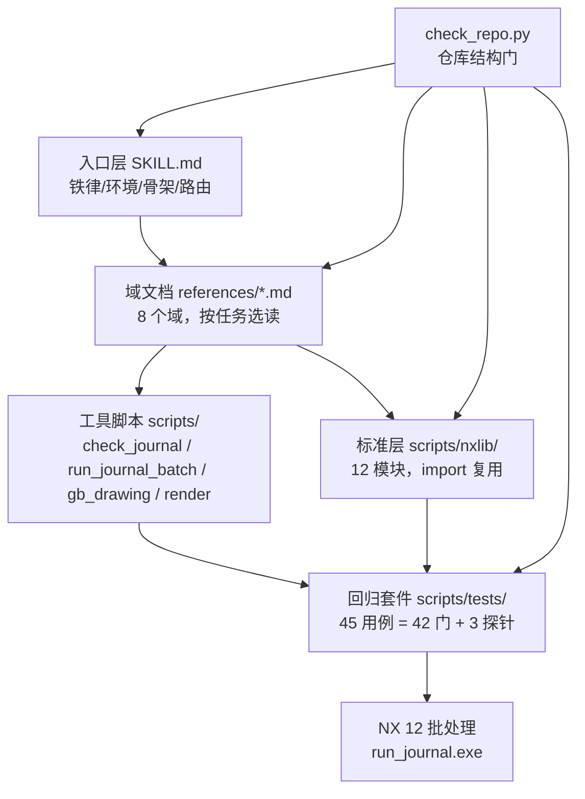

# 架构

## 一句话

本仓库不是软件，是「文档 + 配方 + 可回放的验证件」：agent 读文档写 journal，journal 在 NX 12 批处理里跑，套件把每条结论钉成一个可复跑的用例。

## 五层结构

依赖方向自上而下单向：域文档不 import 任何脚本，nxlib 不 import 用例，用例可 import nxlib，工具脚本可被用例调用。反向依赖只有一处例外——`scripts/gb_drawing.py` 既是被用例 33 验收的模块，也被 `references/gb-drawing.md` 当作 API 文档的宿主（`references/gb-drawing.md:1`）。

## 各层职责

| 层 | 位置 | 职责 | 不变式 |
|---|---|---|---|
| 入口层 | `SKILL.md` | 会话/部件层：铁律、环境事实、journal 骨架、通用部件操作、工作流、域路由 | 唯一保留跨域高发陷阱清单的地方（`SKILL.md:15`） |
| 域文档 | `references/*.md` | 8 个域的成功路线与域内约束 | 域之间不互相依赖；负面事实写成路线里的一句约束，不新开坑位表（`SKILL.md:256`） |
| 工具脚本 | `scripts/*.py`、`*.bat` | 静态检查、批处理执行、国标出图、离线渲染 | 不依赖 NX 也能跑的部分放宿主 Python（`check_journal.py`、`check_repo.py`） |
| 标准层 | `scripts/nxlib/` | 被用例复用的配方：测试框架、部件生命周期、建模、装配、制图、测量、滚球圆角、模板、逆向五表、骨架、结构库、审计 | 配方只在 nxlib 里有一份，用例复制同名函数会被 `check_repo.py` 拦（`scripts/check_repo.py:298`） |
| 回归套件 | `scripts/tests/` | 45 个用例，其中 42 个有判决 token | 判据看输出 token 不看退出码（`scripts/tests/RUN_TESTS.bat:14`） |

## 三份权威，互不重叠

| 问题 | 权威 |
|---|---|
| agent 该怎么干 | `SKILL.md` + `references/*.md` |
| 某个用例验收什么、判什么 token | `scripts/tests/README.md` |
| 仓库结构/文档格式/配方归属是否合规 | `scripts/check_repo.py`（七组检查，`scripts/check_repo.py:1-20`） |

`check_repo.py` 的七组检查把"文档质量"做成了机器门：PY36 语法、用例清单一致、文档结构、文件清单覆盖、标准层独占、agent 文档精简（禁日期与过程叙述）、路线优先（禁坑位表）。这使得域文档只能写结论与做法，验证故事无处落脚——这是本仓库与其他文档型仓库最大的结构差异。

## 为什么分成 8 个域文档

单文件承载全部配方会同时踩两个问题：会话必读内容被淹没；不同域的陷阱互相干扰阅读预算。`SKILL.md` §5 的路由表（`SKILL.md:199`）按任务指向唯一必读文件，跨域任务按依赖顺序读多个，域内允许少量重复（`SKILL.md:217`）。

拆分的判据不是篇幅而是读者：只有两个独立任务域被迫共读一个文件时才拆（`SKILL.md:262`）。装配与工程图就是这样从建模域拆出来的。
