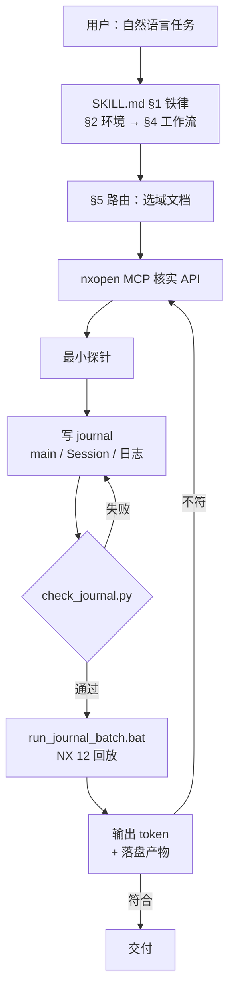

# 主执行流

## 一次任务的完整链路

链路的两端都是人对 agent 的信任问题：前端用 MCP 消除 API 幻觉，后端用 token 与落盘校验消除"看起来成功"。

## 静态门：check_journal.py

`check_journal.py` 不需要 NX，是本仓库唯一能在 CI 独立运行的语义门。

| 阶段 | 做了什么 | 位置 |
|---|---|---|
| 语法 | `ast.parse(..., feature_version=(3, 6))`，按 NX 解释器而非宿主解释器判语法 | `scripts/check_journal.py` 的 `ast.parse(..., feature_version=(3, 6))` |
| 占位符 | 只看注释 token 与真正的 `raise NotImplementedError`，字符串里的 TODO 不误报 | `scripts/check_journal.py` 的占位符扫描（`tokenize.generate_tokens` 只看注释 token） |
| 规则库 | 5.1–5.20 共 20 组已固化的 NX 12 批处理坑位，按 AST 判定（5.3 挂在语法层：裸 `.True`/`.False` 解析不过） | `scripts/check_journal.py` 规则 5.1 起 |

规则库的关键设计：**按变量作用域判定**。同一文件里 `builder.Length = x` 报错，但另一个对象的同名属性不误报（`scripts/check_journal.py` 的 `_builder_vars()` 的 `_builder_vars`）。这是文本匹配做不到的——本技能的用例里有大量刻意演示坑位的探针文件。

豁免只有两种标记（只认注释 token，字符串/docstring 里的同样文字不生效）：整文件 `# check_journal: allow-probes`，单行 `# check_journal: expected-raise`（`scripts/check_journal.py` 的 `_waived()`）。expected-raise 只对按行定位的规则生效（5.1a-5.1f/5.5/5.9/5.14a/5.17/5.20）；allow-probes 跳过 5.1e/5.1f、5.5、5.9、5.10、5.11、5.12、5.13、5.14a/5.14b、5.15、5.17、5.18、5.19、5.20；两种标记都不放行：5.2、5.3（语法层）、5.7、5.8、5.16；5.1a-5.1d 只认 expected-raise。

规则库自身也要被验证：`scripts/tests/verify_check_rules.py` 对 5.1–5.20 每条规则各配一个反例（报错级必须命中，提示级只断言输出提示、退出码仍为 0），干净与"看似该报实际合法"的样本必须通过，由 `RUN_TESTS.bat` 的 `:ruleselftest` 段调用。

## 动态门：run_journal_batch.bat + RUN_TESTS.bat

批处理入口做三件事，都不是可选的：

1. `NX_HOME` 解析，找不到 `run_journal.exe` 就打 `ERROR: run_journal.exe not found under NX_HOME=...` 并以 2 退出（`scripts/run_journal_batch.bat` 的 `:rj_no_nx` 分支）。
2. 工作目录 `pushd` 与无条件回显 `=== RUN_JOURNAL workdir=... ===`——workdir 建失败时 `pushd` 不报错，journal 会在调用者 CWD 里落盘（`scripts/run_journal_batch.bat` 的 workdir 注释）。
3. `call ugiicmd.bat` 后跑 `run_journal.exe`，回显退出码（`scripts/run_journal_batch.bat` 调用 `ugiicmd.bat` 处）。

套件的判决在 `:gate` 子过程：优先用 `scripts/run_journal_checked.py` 判 ok（token + `_FAIL`/`STAGE_FAIL`/`FATAL`/`Traceback`；`memory access violation` 只对 `GATE_ALLOW_CRASH` 登记的 26/28 放行）；宿主无 python 时回退 `findstr` 三连（token + `_FAIL` + 非 `TESTxx_FATAL` 的 `FATAL`）。退出码不参与判决，原因写在文件头：`run_journal` 只把未捕获异常变成非零，journal 按 SKILL.md §3 逐步 try/except 后继续，失败被吞时退出码仍是 0；反过来用例 26 故意复现原生崩溃，日志写 successful 而退出码是 1（`scripts/tests/RUN_TESTS.bat` 文件头的 26 号崩溃说明）。

## 套件的三个收尾段

| 段 | 判据 | 位置 |
|---|---|---|
| 50 个 gate | 逐个 `call :gate <file> <token>`，任一失败 `exit /b 1` | `scripts/tests/RUN_TESTS.bat` 的 `call :gate` 列表 起 |
| ruleselftest | `verify_check_rules.py` 反例全命中、干净样本通过 | `:ruleselftest` 段 |
| runnermarkers | `verify_runner_markers.py`：FATAL/_FAIL/缺 token 必须拒，干净样本通过 | `:runnermarkers` 段 |
| pdfverify | 用例 19 的 PDF 用 pymupdf 读文本层核数值；无 pymupdf 返回 3 判 SKIP 而非 FAIL | `:pdfverify` 段 |

全绿最后一行是 `=== ALL TESTS PASSED ===`（`scripts/tests/RUN_TESTS.bat` 的 `ALL TESTS PASSED`），随后按 `KEEP_PARTS` 决定是否清 `parts/`。

## 两套门的分工

| | 静态门 | 动态门 |
|---|---|---|
| 覆盖 | 语法、占位符、20 组已知坑位 | 结局：几何是否建出来、尺寸是否符合解析解 |
| 依赖 | 宿主 Python，无 NX | NX 12 + Nastran 授权 |
| 能跑在哪 | 本机 + 云端 CI（`.github/workflows/ci.yml` 的 `check_repo.py` 步骤） | 只在装了 NX 的机器（`.github/workflows/ci.yml` 文件头注释） |
| 抓不到 | 运行期崩溃、几何错 | 代码风格、规则回归 |

静态门抓不到的东西正是动态门存在的理由：`Point3d` 传 int 报 `TypeError` 能在静态层拦，但"Commit 成功而文件 2 KB 零实体"只能在动态层发现。反过来动态门拦不住规则退化，所以套件每次都把 `verify_check_rules.py` 跑一遍。

## CI 只跑静态侧

`.github/workflows/ci.yml` 三步：`check_repo.py`、`verify_check_rules.py`、遍历 `scripts/tests/[0-9][0-9]_*.py` 逐个 `check_journal.py`。回归套件本身需要真实 NX 安装，明确写在 workflow 的抬头注释里不接受云端替代。

这也意味着：**改动 nxlib 或域文档后，云端绿灯不代表可交付**，必须在有 NX 的机器上跑全量套件（`SKILL.md` §6）。
