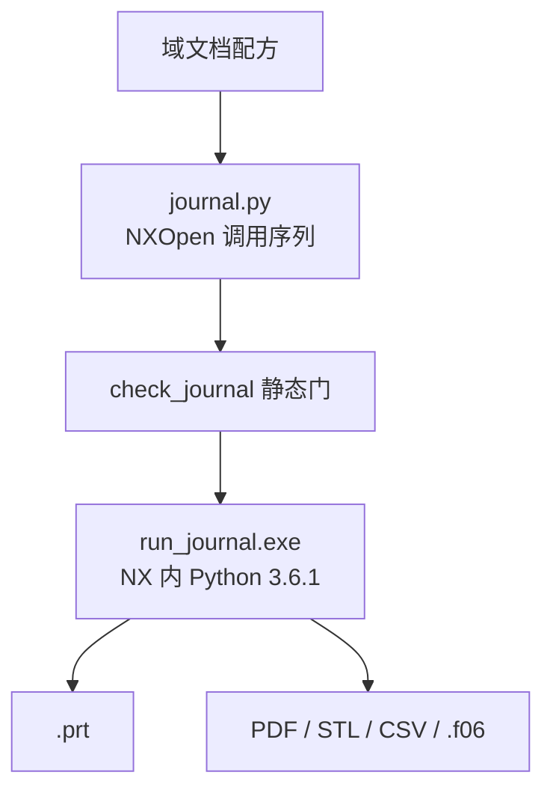
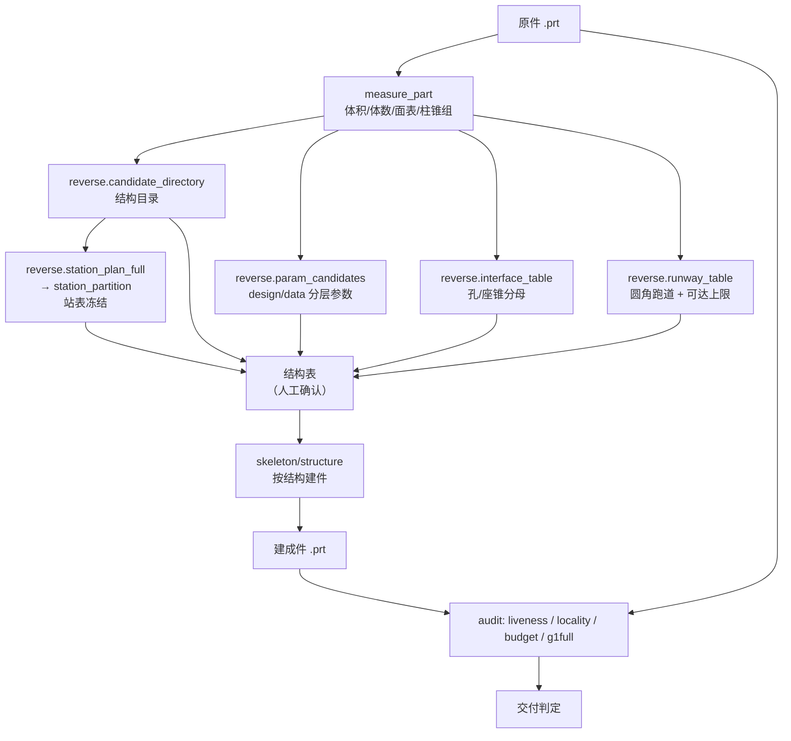
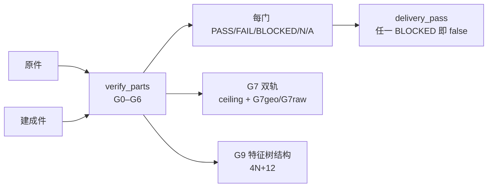
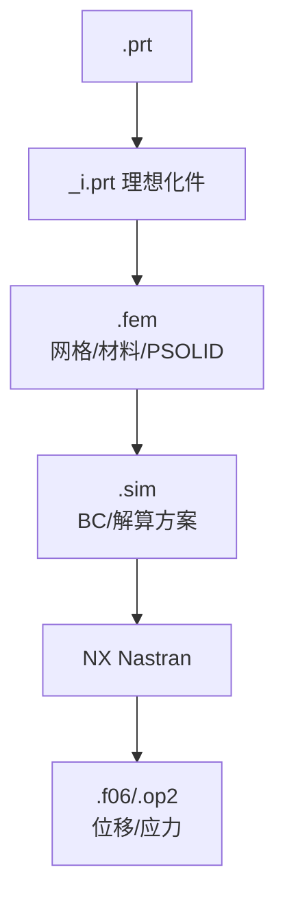
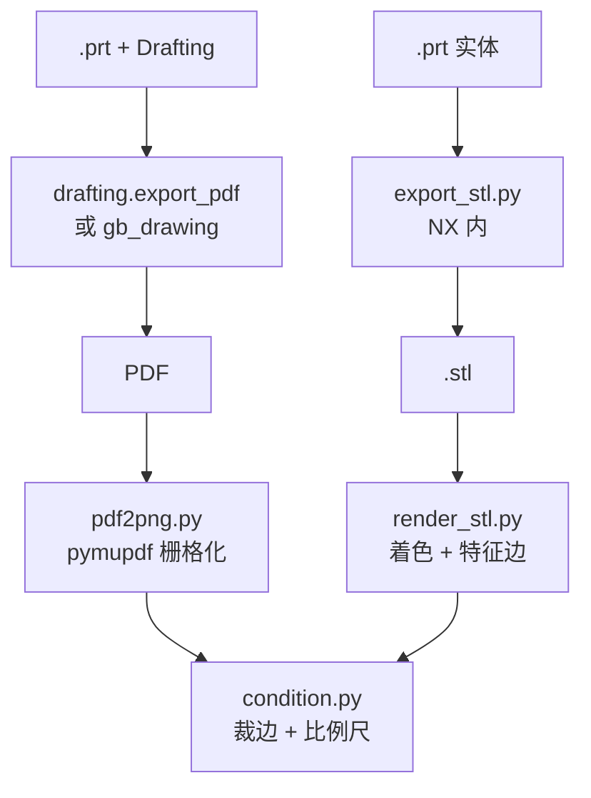
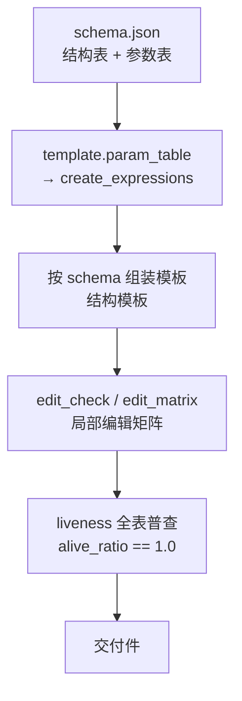

# 数据流

本仓库有六条独立的数据流，共用同一个原则：**测量/参考只作数据，交付件由结构特征构成，证据由独立脚本复算**。自报数字不作证据（`references/reverse-engineering.md` §4.1（门结果由独立脚本复算））。

## 1. journal 生成链（主链）

journal 自身的结构固定：`main()` → `Session.GetSession()` → 部件新建/打开 → 功能段 → 显式保存（`SKILL.md` §4）。每段的 try/except 与逐行 flush 日志是硬要求，因为批处理 stdout 全缓冲、崩溃即丢光（`SKILL.md` §1 第 5 条）。

## 2. 逆向测量编译链（最重的一条）

关键不变式：**分母先冻结**。站表在开工前按原件全集固定，构建结果不能反过来决定分母（`references/reverse-engineering.md` §12.1）。这是"边建边挑站"会让错带通过的直接对策（`references/reverse-engineering.md` §12.1 末段）。

五张表的生成函数在 `scripts/nxlib/reverse.py`：`candidate_directory`、`param_candidates`、`station_plan_full`、`interface_table`、`runway_table`、`station_partition`。

## 3. 验收链（G0–G9）

验收项的机器键、阈值、数据源与"抓什么错"逐项钉在 `references/reverse-engineering.md` §4.1 的表里。两条设计原则：

- 四态判定。`BLOCKED` 只用于几何不可达且已给出上限与残差分解的项，不等于通过（`references/reverse-engineering.md` §4.1（四态判定））。
- 分母不能是自选站。G1 用原件结构分界全集，G7 用同半径跑道数，G9 用结构表行数，三者都不是"我建了几个面/几个特征"。

## 4. FEA 链

文件体系与前置在 `references/fea.md` §0。这条链的数据特征是**三份文件三种保存语义**：`fem.Save()` 只写 `.fem`，不写理想化件；`session.Parts.Work` 对 `.fem/.sim` 直接抛错（`references/fea.md` §0a）。所以部件句柄必须保留 `FileNew().Commit()` 的返回值，不能用 `Parts.Work` 取回。

## 5. 出图链（两条）

批处理截不了图是本仓库的硬约束：`ImageCaptureBuilder` 不落文件、`ufs.Disp.CreateImage` 抛内存访问违例（`SKILL.md` 的「通用 API 路线约束」条目 6）。所以三维图一律走 STL 离线渲染，工程图走 PDF 栅格化。比例尺只在 `render_stl.py` 写边车、由 `condition.py` 落笔，漏跑 `condition.py` 图上就没有比例尺（`scripts/render/README.md` §视角配方）。

## 6. 参数化模板链

这条链的判据不是"改得动"，而是"改对地方"：单参数扰动后 DoUpdate 零回滚零告警、还原逐位复原、无关结构不动（`references/reverse-engineering.md` §11）。

分层是这条链的核心机制：`design` 参数（工程师会给的量）必须落成命名表达式并被特征按名字引用；`data` 参数（测量轮廓、实测轴）只能是字面值，写成表达式就是死参数（`references/reverse-engineering.md` §12.2）。G8 的分母只含 design 参数。

## 六条链的共同点

| 原则 | 表现 |
|---|---|
| 分支判据前置 | 站表、阈值、分母在开工前定，不随后续结果调整 |
| 证据独立复算 | 门结果由独立脚本从交付 PRT/STL 复算，报告数字不作证据 |
| 失败有归因 | `references/reverse-engineering.md` §4.2 的归因表把"哪类差异 → 哪个结构判断错"逐条对上 |
| 产物可复用 | 测量产物是资产，构造可重写；修版复用测量不重测（`references/reverse-engineering.md` §10 第 8 条） |
