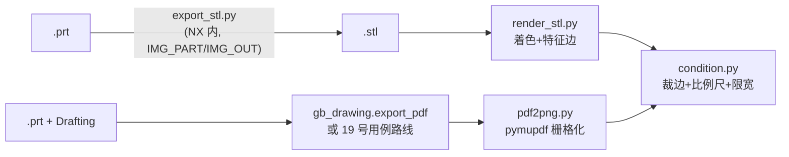

# 离线出图链（NX 批处理截不了图时的替代路线）

NX 12 批处理会话导不出图像（实测 2026-09-23：UF 截图路线内存访问违例，
Gateway builder 提交成功但不写文件），所以三维实体的 README 级图件走
"导 STL → 宿主离线渲染"链，工程图走 "Drafting PDF → 宿主栅格化"链。
本目录是这两条链的全部脚本（宿主脚本依赖 Python 3 + numpy + Pillow +
pymupdf；`export_stl.py` 是 NX 内运行的 journal）。

## 链路

三维件：`run_export.bat part.prt out.stl` → `render_stl.py scene.json` →
`condition.py in.png out.png 1500 1100 14`。工程图：NX 里出 PDF →
`pdf2png.py in.pdf out.png 3.0` → `condition.py` 同样收尾。

## 逐件用法

- **run_export.bat** `<abs .prt> <abs .stl> [workdir]`——env 转发的 wrapper。
  必须经它传参：Git Bash 里 `\\$var` 在双引号内会吃掉反斜杠、journal 收到
  字面 `$n`（实测）；环境变量必须在 cmd 侧 set。日志写在 STL 同目录
  `export_stl.log`，NX 吞掉控制台输出时证据在这里。
- **export_stl.py**（NX journal）——读 `IMG_PART`/`IMG_OUT`；三角公差
  `ChordalTol=0.01`（0.05 在 README 渲染尺寸下圆柱面可见棱面；NX 12 的
  STLCreator 没有 TriangleTolerance）；装配无自身体时回退
  `Scope.EntirePart`。
- **render_stl.py** `<scene.json>` 或 CLI 参数——Z 缓冲平面着色 + 二面角
  25° 特征边，效果对齐 NX"带边着色"视图。场景键：顶层
  `out/w/h/az/el/palette/scalebar`，`parts[]` 每件
  `stl/color/alpha/rotate_z/translate/split_bodies/palette/body_alphas`
  （拆连通体时逐体取调色板与透明度）。CLI 覆盖：
  `render_stl.py in.stl out.png [w] [h] [--az A] [--el E] [--scalebar MM TEXT]`。
  渲染后在 `<out>.scalebar.json` 写比例尺边车（世界长度、像素、渲染盒），
  `condition.py` 裁剪后据它重画比例尺——不写边车，裁剪会把比例尺挪离
  真实位置。
- **pdf2png.py** `<in.pdf> <out.png> [zoom]`——首页栅格化；工程图审计用
  3.0（A4 得约 2526×1786）。
- **condition.py** `<in.png> <out.png> [max_w] [max_h] [pad]`——按非白包围盒
  裁边、白边 pad 像素、限制最大像素；有边车时裁剪后在底部 40px 白条内重画
  比例尺。工程图（有图框）一般不裁（pad 给大些或跳过），三维渲染裁。

## 出图后校验

不要拿渲染 PNG 眼测布局——显示缩放会骗人。工程图数值审计用 pymupdf：
`get_drawings()` 拿线段/圆、`get_text('words')` 拿文字（NX 连字符抽出来是
软连字符 U+00AD、中文抽不出来——按位置与线段核，对 `\xad` 归一化）。
19 号用例的 `scripts/tests/verify_anno_pdf.py` 是现成的复核模板。
